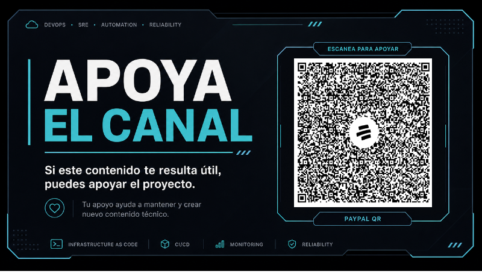

# WSL Action Buttons

Quick actions for the integrated VS Code terminal, designed for VS Code running in WSL.

## Status bar actions

The extension provides five icon-only status bar buttons. Each button has an English tooltip.

| Icon | Action | Description |
|---|---|---|
| `$(clippy)` | Paste and Execute | Executes clipboard content in the active terminal, creating one if needed. |
| `$(terminal)` | Open OpenCode | Opens OpenCode in a dedicated terminal beside the editor. |
| `$(hubot)` | Open Ollama | Opens Ollama with `qwen3:8b-nothink` in a dedicated terminal beside the editor. |
| `$(copy)` | Copy All Output | Selects and copies the available terminal buffer. |
| `$(clear-all)` | Clear Terminal | Clears the active terminal using VS Code's built-in command. |

The status bar displays icons only. Descriptive English titles remain available in the Command Palette.

## Requirements

- VS Code 1.85 or later.
- VS Code integrated terminal.
- For OpenCode, the `opencode` executable must be available in the terminal's `PATH`.
- For Ollama, the `ollama` executable and `qwen3:8b-nothink` model must be available in WSL.

## Notes

Paste and Execute intentionally executes clipboard content. Verify the clipboard before pressing the button, especially when it contains commands or multiline scripts.

Copy All Output is limited to content available in VS Code's terminal scrollback buffer. It cannot retrieve output that VS Code has already discarded.

The extension uses VS Code's configured default terminal profile; it does not force Bash or Zsh.

## Development

Run tests with `npm test` and validate syntax with `node --check extension.js`.

<!-- SUPPORT-LINKS -->
## Support the Project

If you find this extension useful, you can support its development and connect with me through the following channels:

### Bre-B

Scan the QR code to send a contribution using Bre-B.

### Connect on LinkedIn

Scan the QR code to visit my LinkedIn profile and learn more about my professional work.

### Support via PayPal

If you would like to contribute financially, you can use the following PayPal link:

[Support the project via PayPal](https://paypal.me/redesenservidores?locale.x=es_XC&country.x=CO)
